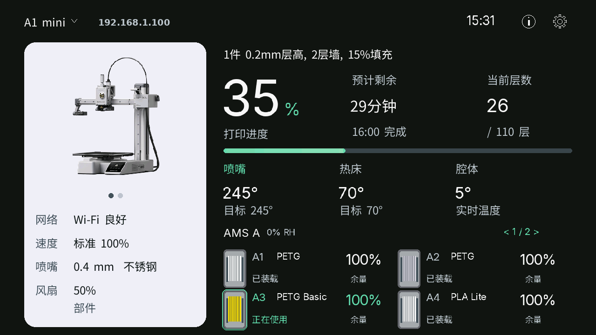

# BambuHelper for M5Stack Tab5

把 [BambuHelper](https://github.com/piaoxuebingfeng/BambuHelper) 的 ESP32-P4 触控看板，
移植到 **M5Stack Tab5**（ESP32-P4NRW32 / 5" 1280×720 MIPI-DSI / 16 MB Flash / 32 MB PSRAM）上的
Arduino IDE 工程。

看板通过 Bambu Cloud 或局域网 MQTT 读取 Bambu Lab 打印机状态，显示打印进度、温度、AMS 耗材、
提醒与机型图；网页端负责配网、下发打印机与显示设置。本工程**不提供切片、打印控制或视频解码**。



<sub>画面由设备端 `GET /screen.bmp?scale=1` 直接导出（非模拟器渲染）；顶栏 IP 已替换为示例值。</sub>

> **最快上手**：装 M5Stack 板包 + M5GFX/ArduinoJson/PubSubClient → 打开 `.ino` →
> 分区方案选 **Custom** → 验证 / 上传。细节见[第 5 节](#5-编译)，
> 报错先看 [5.4 编译注意事项](#54-编译注意事项)。

---

## 1. 这个工程从哪里移植而来

| 项目 | 内容 |
| --- | --- |
| 直接上游 | `piaoxuebingfeng/BambuHelper`，P4 分支，固件版本 `v4.0.4`（`FW_VERSION`） |
| 上游目标板 | Waveshare **ESP32-P4-WIFI6-Touch-LCD-7B**：1024×600 EK79007、32 MB Flash、GT911 |
| 上游构建系统 | PlatformIO + pioarduino `55.03.311` / Arduino-ESP32 `3.3.11`，多 env 区分 P4 芯片版本 |
| 本工程目标板 | **M5Stack Tab5**：1280×720 ILI9881C（首批）+ GT911、16 MB Flash、32 MB PSRAM |
| 本工程构建系统 | **Arduino IDE / arduino-cli**，板包 `m5stack:esp32` ≥ 3.3.7，单板单 env |
| 移植方式 | 业务层源码整体入驻 `src/`（未改逻辑），新增独立 Tab5 板级层；`BOARD_IS_M5TAB5` 只处理板级差异 |

上游项目自身基于 [Keralots/BambuHelper](https://github.com/Keralots/BambuHelper)，其 P4 看板、
云端实景与运行时架构（SPSC 快照 + 独立 worker）由 P4 分支独立维护。本工程沿用这套架构，
**没有**改回小屏单循环模型。

移植的核心判断：**`BOARD_IS_WS_P4_7B` 不是板型开关，而是 P4 运行时架构开关**（约 336 处引用，
控制 SPSC 快照、worker 所有权、PSRAM 分配策略、`loop()` 分叉）。因此它被原样保留，
Tab5 通过新增 `BOARD_IS_M5TAB5` 叠加板级差异。删掉它会退回旧的小屏单循环路径。

### 迁移过程中的结构性变化

PlatformIO 有三个 Arduino IDE 没有等价物的能力，必须改写：

| PlatformIO 机制 | 本工程的替代方案 |
| --- | --- |
| `build_flags` 批量注入 `-D` | `src/board_config.h`，每个编译单元首行 include |
| `board_build.embed_files`（`_binary_*.vlw` 符号） | 预生成头文件 `src/p4_sans_fonts.cpp`、`src/p4_printer_artwork.h` |
| `extra_scripts` 构建时生成 `web_assets_gz.h` | `tools/prepare_assets.py` 离线生成并提交 |
| 多 env（芯片版本 / 有无实景） | 单板单 env，删掉芯片版本分支 |
| `src/` + `include/` + `lib/` 三处布局 | 合并为 Arduino sketch 的 `src/`（含私有头 `LovyanGFX.hpp`、`TutkSession.hpp` 等） |

---

## 2. 当前工程的功能

以下为固件当前具备的能力。带 **（实测）** 的是本机实板验证过的路径（云端 P1S / A1 / A1 mini
三台同时在线）；其余功能沿用上游逻辑、本机未逐项验证。

**打印看板**
- 打印概览（实测）：任务名称（中文正常显示）、大号进度百分比、渐变进度条、预计剩余、完成时刻、当前层数/总层数。
- 打印参数（实测）：左右喷嘴、热床、腔体温度（含目标值）、网络状态、速度档位、喷嘴规格、三路风扇。
- AMS / 耗材（实测）：四槽一页，耗材颜色、类型、装载状态、余量、温湿度、正在使用的槽；支持 AMS、AMS HT、外挂耗材。
- 机型图与实景：左侧图片区显示内置机型图（实测）；配置了局域网摄像头时可切换实景（本机无 LAN 摄像头，未验证）。
- 详情页：右上角 `i` 进入任务 / 耗材 / 设备 / 提醒四页，顶部箭头返回；提醒页可上下滑动；60 秒无操作自动返回。
- AMS 翻页：默认跟随正在使用的 AMS，手动翻页后保持用户选择。

**多打印机**（实测）
- 配置槽 4 个（`MAX_PRINTERS`），**同时连接 3 台**（`MAX_ACTIVE_PRINTERS`，Tab5 专属值）。
- 点击左上角名称区轮换打印机（本工程新增名称右侧下拉箭头提示）。

**时钟 / 屏保**
- 打印完成后经过设定等待时间（`finishDisplayMins`）自动进入时钟屏保，可切 pong 时钟样式。
- 触摸唤醒返回看板；唤醒时背光分 12 步渐亮（约 240 ms），避免电流阶跃。

**设置页（设备端）**
- 本机配置网址 + 二维码，以及触摸操作 / 多打印机切换的说明。
- 亮度、旋转等参数不在此页调整，走网页（设备端只保留网址入口）。

**Web 配置页**
- Wi-Fi 配网与扫描、打印机槽位（LAN / 云端）、显示与亮度、通知与声音、仪表标签、
  设置导入导出、云端登录（国区 `cn`）、`/status` `/debug` 诊断、`/screen.bmp` `/card.bmp` 截图。
- **中英文切换**：顶部语言按钮，跟随浏览器语言，选择记在 `localStorage`（本工程新增）。

---

## 3. 与上游工程的区别

### 3.1 硬件与资源

| 项目 | 上游 7B | 本工程 Tab5 |
| --- | --- | --- |
| 屏幕 | 1024×600 EK79007，横屏原生 | 1280×720 ILI9881C，**原生竖屏 720×1280**，靠 rotation 3 横置 |
| 触摸 | GT911，坐标即逻辑坐标 | GT911 @0x14，**raw 坐标是竖屏 720×1280**，需复刻转换 |
| Flash | 32 MB，双 OTA 槽 | **16 MB**，单 15 MB app 槽，**无 OTA** |
| PSRAM | 32 MB | 32 MB（一致） |
| 板级上电 | 7B 自己的 GPIO | **PI4IOE5V6408 两片**（0x43/0x44）控制 LCD_RST / TP_RST / CAM_RST / SPK_EN / WLAN_PWR_EN |
| 无线 | ESP32-C6 SDIO（18/19/14..17/54） | ESP32-C6 SDIO（**12/13/11/10/9/8/15**），且 P0 必须先拉高才有供电 |
| 音频 | ES8311 + I2S 提示音后端 | **不编译**（Tab5 是 ES8388/ES7210，工程内无驱动），强制静音 |
| 电池 | AXP2101 后端 | **未接入**（无 INA226 后端），电量不显示；INA226 仅用于串口电源取证 |
| 射频功率 | 默认 19.5 dBm | **11 dBm**（`BOARD_WIFI_TX_POWER`），压 RF 峰值电流 |

### 3.2 软件行为

| 项目 | 上游 7B | 本工程 Tab5 |
| --- | --- | --- |
| 布局 | 1024×600 手写坐标 1:1 输出 | 1024×600 坐标 **统一 ×1.2** 到 1280×720（`ScaledGfx`，两侧各留 26 px 同色边） |
| 中文字库 | 源码字符集子集（约 380 字 / 170 KB） | **完整 GB2312**（7546 码位 / 4.01 MB VLW），任务名不再出方框 |
| 同时连接打印机 | 2 台 | **3 台** |
| 云端实景（TUTK） | 有实验构建开关 `P4_CLOUD_CAMERA_EXPERIMENTAL` | **未定义，整条链路编译剔除** |
| 板载 MIPI-CSI 摄像头 | 未使用 | 未使用 |
| RS485 / CAN / 麦克风 / microSD | 未使用 | 未使用 |
| OTA | 双槽 + 网页 OTA + 回滚 | **不可用**：无 app1 槽，`/ota/upload` 会报 "no OTA partition found" |
| 固件体积 | 32 MB Flash，不受体积约束 | **8.3 MB**（其中 4 MB 是完整中文字库） |

### 3.3 新增文件（上游没有）

```
partitions.csv              单 15 MB app 槽（overrides 板包默认双 6.5 MB）
build.sh                    CLI 可复现构建，自动带 PartitionScheme=custom
src/board_config.h          替代 ws_p4_lcd_7b.ini 的 -D 宏矩阵
src/ws_p4_7b_config.h       7B 引脚保留表在 Tab5 上返回 false
src/m5tab5_board_io.{h,cpp} PI4IOE5V6408 上电时序、GT911 硬复位、INA226 读数
src/m5tab5_board.cpp        编译期自检（板级宏、资产体积、字库完整度）
src/lgfx_boards.h           LGFX_M5TAB5 面板类（Bus_DSI + Panel_ILI9881C）
src/LovyanGFX.hpp           转发到 M5GFX 的兼容垫片
tools/prepare_assets.py     重新生成网页 gzip 资源
tools/build_cjk_font.py     重新生成 GB2312 中文字库
tools/redact_screenshots.py 截图去敏（局域网 IP / 二维码）
docs/                       上板日志、实拍截图、字体许可证
reference/main.cpp          上游 main.cpp 原样存档，便于逐行对照
```

---

## 4. 移植过程中做的改进

提交历史按阶段推进（`git log --oneline` 可逐条对照），按主题归类如下。

| 阶段 | 内容 | 属于 |
| --- | --- | --- |
| 0–4 | 工程骨架、板级宏层、资产裁切、业务源码入驻、首次完整编译 | 移植 |
| 5 | PI4IOE5V6408 上电时序（C6 供电 + LCD_RST/TP_RST 拉低 → 释放 → 100 ms 面板/触摸启动）、DSI 面板类、GT911 探测 | 移植 |
| 6 | `setup()/loop()` 接入真实看板；`hostedSetPins()` 早于首次 Wi-Fi 调用 | 移植 |
| 7 | **横屏修正**：逻辑 0/180 → 硬件 rotation 3/1；**触摸坐标映射**：竖屏 raw → 横屏 → 逆缩放；隔离 7B 引脚保留表 | 修 bug |
| 8 | 配网页 Rescan 卡死、Save 无响应的两处阻塞 | 修 bug |
| 9 | `/screen.bmp` 在 1280×720 上永久 503 且串口刷屏 | 修 bug |
| 10 | 全屏 1280×720（统一 1.2 缩放）、修复进度百分比压到数字上 | 功能 + 修 bug |
| 11 | **GT911 完全无响应**：缺 58 ms 唤醒脉冲（读得到产品 ID，配置区全 0、永不报帧） | 修 bug |
| 12 | 射频峰值电流上限 11 dBm，消除 USB 供电下的 BOD 重启循环 | 加固 |
| 13 | 多打印机切换可用（Tab5 放开到 3 台）、名称区下拉箭头 | 功能 |
| 14 | 中文任务名完整显示（GB2312 全字库）、顶部名称去重 | 功能 + 修 bug |
| 15 | **Web 配置页中英文切换**（前端字典 + `localStorage`，响应体补 `charset=utf-8`） | 新功能 |
| 16 | **背光斜坡**：离开时钟页时亮度 30→200 一步跳变叠加全屏重绘导致 BOD；改为 12 步 / 240 ms 渐亮 | 修 bug |
| 17 | **顶栏图标点不中**：950–967 的 17 px 死带、`excursion ≤ 24`（≈2.9 mm）过严；改为无缝命中区 + `excursion ≤ 56`，并新增按下变绿反馈 | 修 bug + 交互 |
| 18 | **"变绿但不进页"**：手势状态每帧重算，按住期间一次读坐标失败就清 tracking；改为只在按下沿严格校验、松手一律判定 | 修 bug |
| 19 | 文档截图与启动日志去敏（IP / 二维码 / MAC / AP 名），并重写 git 历史 | 工程化 |

其中 7 / 11 / 16 / 17 / 18 是"看起来像硬件故障、实际是软件缺陷"的典型，读代码时值得先看这几处注释。

---

## 5. 编译

### 5.1 Arduino IDE（推荐，也是日常调试路径）

第 1 步：安装 **Arduino IDE 2.x**。

第 2 步：首选项 → 附加开发板管理器网址，加入

```
https://static-cdn.m5stack.com/resource/arduino/package_m5stack_index.json
```

国内网络可用镜像 `.../package_m5stack_index_cn.json`。

第 3 步：开发板管理器安装 **M5Stack esp32**，版本 **≥ 3.3.7**（实测 3.3.7）。

第 4 步：库管理器安装下面三个库（版本为实测可用值）：

- **M5GFX** ≥ 0.2.23 — 显示驱动。必须用 M5GFX：它内含 lgfx v1.2.x，并带 esp32p4 的
  `Bus_DSI` / `Panel_ILI9881C` 与 Tab5 的 DSI 时序。
- **ArduinoJson** 7.x（实测 7.4.3）— 设置、MQTT、Web API。
- **PubSubClient** ≥ 2.8（实测 2.8）— MQTT 传输。

> **不要安装独立的 LovyanGFX**。`src/LovyanGFX.hpp` 已经把 `lgfx::` 转发到 M5GFX，
> 两份 `namespace lgfx` 同时存在会到处重定义。

第 5 步：打开 `BambuHelper_M5Tab5/BambuHelper_M5Tab5.ino`（打开整个文件夹，不要只打开 .ino）。

第 6 步：在"工具"菜单里设置：

- 开发板：M5Stack → **M5Tab5**（FQBN `m5stack:esp32:m5stack_tab5`）
- **Partition Scheme：Custom** ← 关键，见 5.4 第 1 条
- Flash Size：16MB (128Mb)（板型唯一选项）
- PSRAM：Enabled（默认）
- USB Mode：保持默认（Hardware CDC and JTAG）
- CPU Frequency / Upload Speed：默认

第 7 步：点"验证"编译；接上设备后点"上传"。

### 5.2 命令行

```bash
cd BambuHelper_M5Tab5
./build.sh          # 等价于 IDE 的"验证"，产物在 ./build
```

`build.sh` 做的事：挑选 `arduino-cli`（`$ARDUINO_CLI` → `~/.local/opt/arduino-cli/` →
`/usr/local/bin` → 脚本里记的本机路径 → `command -v`），带
`--board-options PartitionScheme=custom`，并对 0.35 版 CLI 自动省略不支持的
`--board-options` / `--jobs`。换机器时优先设 `ARDUINO_CLI=/path/to/arduino-cli`。

烧录：

```bash
arduino-cli upload -p /dev/ttyACM0 \
  --fqbn m5stack:esp32:m5stack_tab5 \
  --board-options PartitionScheme=custom \
  --input-dir build
```

也可以整片烧 `build/BambuHelper_M5Tab5.ino.merged.bin` 到 `0x0`（含 bootloader + 分区表）。

### 5.3 串口

- 波特率 **115200**，设备枚举为 `/dev/ttyACM0`（USB-Serial/JTAG）。
- 用脚本读串口时**必须先置 `dtr=False; rts=False`**，否则会拨动 USB-JTAG 的复位 strapping。
- 健康启动顺序：`PI4IOE 0x43/0x44 ready` → `tft.init()` → `setRotation` → `netif_ready` →
  `GT911 @0x14 (id 911)` → `AP BambuHelper-XXXX` → `Web server :80`。
- `setup()` 与 `loop()` 每 5 s 打印一行 `[pwr] vbus=..V shunt=..mV heap=..`，用于追欠压。

### 5.4 编译注意事项

1. **必须选 Partition Scheme = Custom**。
   板包默认方案 `default_16MB` 是 2 × 6.5 MB app（`upload.maximum_size=6553600`），
   本工程固件 8.3 MB，用默认方案必报（下面这段是实际报错原文）：
   ```
   Sketch uses 8300082 bytes (126%) of program storage space. Maximum is 6553600 bytes.
   text section exceeds available space in board
   ```
   `PartitionScheme.custom` 的 `build.partitions` 是空值，含义是"读 sketch 目录下的
   `partitions.csv`"——本工程根目录已有该文件（app0 = 0xF00000 = 15 MB），所以只需在菜单里选
   Custom，**不需要改任何文件**。
2. **`partitions.csv` 不能带 UTF-8 BOM**，否则分区表解析失败。
3. **nvs 与 otadata 的偏移刻意与板包默认一致**（`0x9000/0x5000`、`0xe000/0x2000`），
   所以换分区方案重新烧录不会丢 Wi-Fi 凭据和打印机槽位。改表时不要动这两行。
4. **改动了网页资源要重新生成**。`src/web_assets_gz.h` 是离线生成的 gzip 快照，
   源文件在上游仓库 `../BambuHelper/web/app.css|app.js`：
   ```bash
   python3 tools/prepare_assets.py            # 默认源目录 ../BambuHelper
   python3 tools/prepare_assets.py --source /path/to/BambuHelper
   ```
   不重跑的话设备仍然发旧资源（改了 i18n 字典也看不到效果）。
5. **不要用 0.35 版 arduino-cli 做首次构建**。它会对每个候选库的每个源文件重跑
   include 探测，仅 M5GFX 就要 ~35 分钟才开始产出第一个 .o；1.x 是增量探测。
6. **首次全量编译约 40–75 s**（24 线程）。`src/p4_sans_fonts.cpp` 是 20 MB 单文件、
   `display_ui.cpp` 280 KB，吃内存较多，建议 ≥ 8 GB 空闲内存。
7. **固件体积 8.3 MB / 49%**（相对 16 MB 报备上限），15 MB 槽的实际占用约 53%。
   再往里加 4 MB 级别的东西之前先看分区。
8. `.ino` 里显式 include 了 `<Preferences.h>` `<esp32-hal-hosted.h>` `<esp_system.h>`：
   Arduino 只在 sketch 源显式引用时才把这些核心库加进 include 路径，删掉会引发
   `__has_include` 分支判错。新增依赖核心库的 .cpp 时注意同样的处理。
9. `build/` 已在 `.gitignore` 里，产物不要提交；`.bin` `.elf` `.map` 同理。
10. 编译失败提示 `Tab5 panel init failed`：检查 PSRAM 是否 Enabled（PSRAM 速度需 200 MHz）。

---

## 6. 运行与配置

1. 首次上电进入 AP 配网：SSID `BambuHelper-XXXX`（后 4 位取自 MAC），默认密码 `bambu1234`，
   浏览器打开 AP 网关 `192.168.4.1`（串口也会打印）。配网页是强制门户，任意域名会被重定向。
2. 填 Wi-Fi → 设备重启并连接 → 记下屏幕顶栏显示的局域网地址（设置页二维码也指向它）。
   若在网页里设了主机名且 mDNS 开着，也可用 `http://<hostname>.local` 访问。
3. 打开该地址的网页：
   - **打印机**页填序列号与访问码；云端打印需先在"云端"页登录 Bambu 账号（国区 `cn`）。
   - 云模式下 `cloudUserId` 由后台 30 s 内自动补齐，不用手填。
4. 设备端右上角齿轮进设置页（配置网址、二维码、操作说明）；`i` 进信息页。

配网 AP 页面与主配置页是两套资源，语言各选一次。

---

## 7. 诊断

| 入口 | 用途 |
| --- | --- |
| `GET /debug` | `reset_reason`（`brownout` 是最快定位重启原因的手段）、`uptime`、`min_heap`、`touch{...}`、`touch_taps{presses,taps,drops,swipes,last_ms,last_exc,last_gesture,last_action}`、`p4_page` |
| `GET /status` | 各槽连接状态与实时打印数据 |
| `GET /screen.bmp?scale=1` | 按需生成一帧截图。`scale` 是**降采样倍数**：`1` → 1280×720（全分辨率）、`2` → 640×360、`3` → 426×240（默认）、`4` → 320×180；`&header=1` 只截顶栏 76 px。连发时若上一帧未被取走，会返回 200 + 纯文本 `Screen snapshot is not ready…`（不是 BMP），隔 1–2 s 重试即可 |
| `GET /brightness?val=N` | 亮度预览（经 UI 预览队列，与网页改亮度同一条路径），可用来反复加压验证背光斜坡 |

注意 `/debug` 的 `p4_page` 是 `int8_t`，首页（-1）会显示成 **255**。

触摸问题的判读方法：
`presses` 不涨 = 运行时没看到手指；`drops` 涨 = 手势被判成 None；`taps` 涨但 `last_action=0` = 命中框没中。

---

## 8. 已知限制与注意事项

**硬件**

1. **供电是硬约束**。Tab5（C145 SKU）不含电池，5" 背光 + C6 发射 + DSI 满负荷远超
   电脑 USB 口的 500 mA。用 PC USB 供电视为调试用途；正常使用请接 **5 V / 2 A 适配器**
   或装 NP-F550 电池包（K145 SKU）。欠压症状是 `E BOD: Brownout detector was triggered` +
   `rst:0x3` 循环重启，`/debug` 里 `reset_reason=brownout`。
2. **屏幕有批次差异**。首批（2025-05-09 起）是 ILI9881C + GT911 @0x14，本工程按此实现；
   2025-10-14 后改为 ST7123（TDDI，触控 @0x55），2026-04-28 后为 ST7121。
   换批次机需要改 `src/lgfx_boards.h` 的面板类（M5GFX 已带 `Panel_ST7123` / `Panel_ST7121`）
   与触摸驱动。请以机身背面贴纸为准。
3. **无蜂鸣器、无震动马达**。触摸反馈只能是屏幕上的颜色变化（顶栏图标按下变绿）。
   扬声器（NS4150B）硬件通电，但工程内没有 ES8388 驱动，固件不发任何声音。
4. **电池电量不显示**：`BOARD_HAS_BATTERY` 未定义（BambuHelper 只有 AXP2101/ADC 后端，
   没有 INA226 后端，强行打开会编出空 `battery.cpp` 并链接失败）。

**软件**

5. **无 OTA**：单 app 槽，网页 OTA 上传会失败，只能用 USB 刷写。刷写不需要整片擦除。
6. **云端实景未编译**（`P4_CLOUD_CAMERA_EXPERIMENTAL` 未定义），左侧图片区固定显示机型图；
   局域网摄像头（`camera_client`）通路保留。
7. **同时连接上限 3 台**。想接第 4 台改 `board_config.h` 的 `MAX_ACTIVE_PRINTERS`，
   但每路约 40 KB MQTT 环 + 40–50 KB mbedTLS，还要占 Wi-Fi 空口，注意电流与内存。
8. **中文字面固定 24 px**，不随 1.2 缩放放大；小号中文由调用处 scale 到 0.85。
   要更大字号必须重新生成 3755 字 × 32 px 子集（约 7 MB），体积会再涨。
9. **每次点击图标会触发一次全屏重绘**（约 40 ms）。这是按下变色的代价；
   如果 BOD 复发，优先怀疑这里与背光斜坡的叠加。
10. 云 MQTT 固有延迟 1–2 s，token 约 90 天过期（2FA 账号无法自动续期）。

**个人信息**

11. 本仓库的截图与启动日志已去敏为假地址 `192.168.1.100`、假 MAC `30:ed:a0:00:00:00`。
    **新增截图后请运行** `python3 tools/redact_screenshots.py docs`（幂等，靠 PNG tEXt 标记跳过已处理文件）。
    不要提交 NVS 备份、token、私钥、真实腔体图片。

---

## 9. 目录结构

```
BambuHelper_M5Tab5/
├── BambuHelper_M5Tab5.ino     两个 Arduino 入口 + 电源取证 + ESP-Hosted 引脚
├── partitions.csv             单 15 MB app 槽（PartitionScheme=Custom 读取）
├── build.sh                   CLI 构建
├── src/
│   ├── board_config.h         ★ 板级宏矩阵，所有编译单元首行 include
│   ├── m5tab5_board_io.*      ★ PI4IOE 上电时序 / GT911 硬复位 / INA226
│   ├── m5tab5_board.cpp       ★ 编译期自检
│   ├── lgfx_boards.h          ★ LGFX_M5TAB5（Bus_DSI + Panel_ILI9881C）
│   ├── ws_p4_7b_config.h      ★ 7B 引脚表在 Tab5 上失效
│   ├── LovyanGFX.hpp          ★ 转发到 M5GFX
│   ├── app_main.cpp           业务主循环（上游 main.cpp）
│   ├── display_ui.cpp         屏幕状态机（splash / 看板 / 时钟 / 关屏）
│   ├── display_p4.cpp         P4 看板绘制（ScaledGfx 1.2×）
│   ├── display_p4_runtime.cpp 看板触摸入口、重绘调度
│   ├── p4_dashboard_layout.h  布局常量 + 手势判定 + 触摸坐标映射
│   ├── button_touch_gt911.cpp GT911 后端（含 Tab5 硬复位与原生坐标边界）
│   ├── p4_*.{h,cpp}           P4 运行时：快照、worker、TLS 内存、云、摄像头
│   ├── bambu_mqtt.cpp / bambu_cloud.cpp   MQTT 与云 API
│   ├── web_server.cpp / web_pages.h / web_template.cpp   配置网页
│   ├── p4_sans_fonts.cpp      ⚙ 生成：GB2312 字库 4.01 MB（20 MB 源码）
│   ├── p4_printer_artwork.h   ⚙ 生成：机型图
│   └── web_assets_gz.h        ⚙ 生成：网页 gzip
├── tools/                     三个生成/去敏脚本（见上）
├── docs/                      上板日志、实拍截图、字体许可证
└── reference/main.cpp         上游 main.cpp 存档
```

★ 为移植新增；⚙ 为生成文件（不要手改）。

---

## 10. 改代码前必须知道的几条

- **布局坐标是 1024×600 逻辑画布**。画到屏幕上要经 `p4ui::sx/sy/slen`（×1.2，含 26 px 居中偏移）；
  触摸点进来要经 `p4ui::ux/uy` 逆缩放。`ux()` 含 `-26` 偏移，**只能用于绝对坐标，宽度和高度一律用 `uy()`**
  （用错过一次：`textWidth()` 误用 `ux()` 导致宽度少报 22 px，百分号压到数字上）。
- **画面是"画进 PSRAM sprite → 整帧 pushSprite"**。直接往 `tft_ptr` 画的内容会被下一帧覆盖，
  任何反馈都必须进 sprite 光栅化阶段。sprite 尺寸必须取 `p4ui::W/H`。
- **包装 LovyanGFX 时颜色形参必须 `uint16_t`**。`uint32_t` 会命中 RGB888 重载二次转换
  （`0x10A2` 深灰变纯蓝）。
- **`P4_SETTINGS_OWNER` 是影子副本**：`web_server`/`web_template` 是 `p4Web`，`settings` 是 `p4Settings`，
  `wifi_manager` 是 `wifiSettings`。跨文件读 `rotState.*` 读到的是另一份副本；要看真实 UI 状态用
  `p4HttpUiSnapshot(ui)`。
- **同一固件只能有一个 I2C 所有者**。面板走 MIPI-DSI、不碰 I2C，所以 Arduino `Wire` 可用；
  一旦引入 M5GFX 的触摸对象或任何 `lgfx::i2c::init`，`Wire` 会在 `display.init()` 后被永久抢走。
- **`loop` 任务栈是 24 KB**（`SET_LOOP_TASK_STACK_SIZE(24*1024)`），VLW 大字号绘制需要。
- 网页文案是**英文硬编码在 C++ 模板里 + `web/app.js` 的 `I18N_ZH` 字典**。加新文案时
  两处都要动，否则中文界面只显示英文。

---

## 11. 来源与许可

- 业务层源码、界面构图与运行时架构来自 **BambuHelper 的 P4 分支**（`piaoxuebingfeng/BambuHelper`，
  固件版本 `v4.0.4`），上游最初基于 `Keralots/BambuHelper`。本工程只做板级移植与适配。
- `src/TutkSession.cpp` 等文件标注 `SPDX-License-Identifier: AGPL-3.0-only`
  （改编自 open-bamboo-networking）；机型图素材源自 Bambu Studio。**包含这些模块的固件分发需遵守 AGPL-3.0**。
- `src/p4_sans_fonts.cpp`：Noto Sans SC Regular 400 / 24 px，**SIL OFL 1.1**，
  许可证全文见 `docs/licenses/NotoSansSC-OFL.txt`，来源与再生成方法见 `docs/licenses/README.md`。
- 耗材图形保留 ISC 许可。
- 上游的 `assets/p4/NOTICE.md`、`lib/BambuTUTK/NOTICE.md` 尚未随迁到本工程，
  `src/p4_printer_artwork.h` 头部引用的就是它。对外分发前需要补这两份声明。

---

## 12. 文档索引

| 文件 | 内容 |
| --- | --- |
| `docs/bringup-2026-11-14.log` | 首次上板逐行启动日志（修复前/后），含固件大小、烧录耗时 |
| `docs/dashboard-a1mini-1280x720.png` | 1280×720 全屏看板实拍（A1 mini 打印中，中文任务信息） |
| `docs/cjk-job-title-2026-11-14.png` | 中文任务名 + 多打印机下拉箭头 |
| `docs/multi-printer-switch-2026-11-14.png` | 三台打印机轮换 |
| `docs/web-i18n-zh-*.png` | Web 配置页中文界面（打印机 / 硬件 / 颜色） |
| `docs/touch-settings-page-2026-11-14.png` | 设置页（网址 + 二维码） |
| `docs/backlight-ramp-after-fix-2026-11-14.png` | 背光斜坡修复后 |
| `docs/licenses/` | 字体许可证与再生成说明 |

上游架构文档（SPSC 快照与 worker 所有权、云端实景配置、P4 安装说明）见上游仓库
`docs/P4-RUNTIME-SEQUENCE.md`、`docs/P4-CAMERA-RESEARCH.md`、`docs/ESP32-P4-7B.md`——
本工程沿用同一套运行时语义，只在板级层不同。
